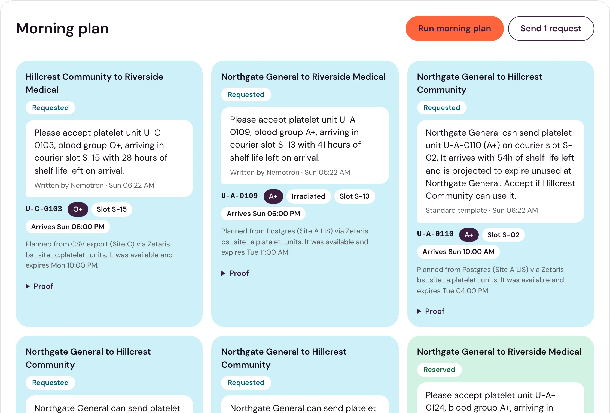

# Bloodshift

**Platelets that reach the right hospital on time.**

Live demo: https://bloodshift.midelabs.xyz (synthetic hospitals, no real patients)



## The story

Platelets last about five days. One hospital throws them out while a hospital down the road runs short, because nobody can see the whole network's live stock in time.

Sharing stock between sites is already proven to fix this. Adelaide's BloodMove program cut platelet wastage from [17% to 7.8%](https://www.blood.gov.au/sites/default/files/documents/2024-09/D15%20109791%20%20Better%20Practice%20Case%20Study%20%20BloodMove%20Platelets%20%20a%20successful%20system%20to%20significantly%20reduce%20platelet%20wastage_RT.pdf), and Emory's hospitals saw [about 20% fewer outdates](https://ideas.repec.org/a/inm/oropre/v71y2023i5p1756-1776.html) after they started moving units between sites.

Those programs still run on manual stock posting, reports and phone calls. Bloodshift does the same job from each hospital's own live record, and proves every move.

## One-liner

Bloodshift isn't a data warehouse, a sync pipeline or a chatbot that decides where blood goes. It reads every hospital's live platelet stock in place through Zetaris, and it follows one rule: **no live row, no move.** A unit moves only if the sending hospital's own system still shows it available at the moment the receiving lab accepts.

## How it works

Every hospital keeps its own system. Zetaris reads all of them in place, with nothing copied. One federated SQL statement joins every hospital's available units with the courier's open slots, and only routes it returns can become transfers.

A fixed rule finds units that would expire unused and lists every transfer that passes the business rules. NVIDIA Nemotron picks among those options and writes the request. It can't add a unit, site or slot.

When a lab accepts, Bloodshift reads the unit and the courier slot again. If either changed, it refuses and writes nothing. Otherwise it reserves the unit in the sender's own system and books the courier.

Every step is an event in the Meterless World Model, and every decline reason is kept in Meterless H-MEM for the next plan.

| Operation | Who | What happens |
|---|---|---|
| Read stock | Anyone | Zetaris queries 2 Postgres databases, a CSV export and the courier's REST API live |
| Run the morning plan | Coordinator | The rule projects outdates and builds options. Nemotron chooses and writes the requests. Nothing is reserved yet |
| Send requests | Coordinator | Each request lands in the receiving lab's inbox |
| Accept | Receiving lab | One federated statement re-reads the hospital's unit row and the courier's slot together, then a conditional reservation at the source and a courier booking. A final read confirms both |
| Accept a unit that changed | Receiving lab | Refused with the source's reason. Nothing is written, and another unit is offered |
| Decline with a reason | Receiving lab | The reason goes to H-MEM, and the unit is offered to another site, never the one that declined |
| Retry | Receiving lab | A failed attempt, like a courier outage, is released cleanly and can be retried |

## Try it in 2 minutes

Open https://bloodshift.midelabs.xyz/app.

1. **See live stock.** Three hospitals and the courier, each row labelled with the system it came from and the time Zetaris read it.
2. **Run the morning plan.** Click Run morning plan, then Send. Each request says whether Nemotron or the standard template wrote it.
3. **Accept one.** Switch View as to Riverside Medical lab, or open [/app?view=SITE_B](https://bloodshift.midelabs.xyz/app?view=SITE_B), and click Accept. The card shows what it's checking, then Reserved with a courier booking ID.
4. **Open Proof.** Every transfer has a Proof drawer with the exact SQL Zetaris ran at planning, at the accept re-check and after the writes, plus the full state history.
5. **Break the rule.** On another waiting request, click Mark used under Try the refusal. That changes the unit in the sending hospital's own database or CSV, the way its lab system would, and Bloodshift isn't told. Now click Accept. It's refused with the hospital's reason, nothing is reserved or booked, and a replacement is offered. Proof shows the hospital's own row read directly, next to the Zetaris re-check.
6. **Decline one.** Decline another request with a reason. The unit goes to another site, and the reason shows under What you've told the network.

## How I tried to break it

Every case below has a unit test. The ones marked Live were also checked against the real Zetaris, Postgres, CSV and courier.

| Case | Outcome | Proof |
|---|---|---|
| Unit marked used at its source before accept | Refused with the source's reason. No reservation, no booking, replacement offered | [test](test/accept.test.ts#L94), [replacement](test/planner.test.ts#L172), [source control](test/accept.test.ts), Live, and on the live demo with Mark used |
| Row changes between the Zetaris read and the write | The conditional write fails, so nothing is overwritten | [test](test/accept.test.ts#L112) |
| Courier slot taken by someone else | Refused, and the reservation is released | [test](test/accept.test.ts#L143) |
| Courier down during accept | Fails, releases the unit, and Retry succeeds later | [test](test/accept.test.ts#L131), Live |
| Zetaris unreachable during accept | Fails without writing anything, retries cleanly | [test](test/accept.test.ts#L121) |
| Accept double-clicked | Books once | [test](test/accept.test.ts#L159) |
| Wrong site tries to accept or decline | Rejected. Only the receiving site can | [accept](test/accept.test.ts#L168), [decline](test/planner.test.ts#L183) |
| Malformed transfer ID | Rejected before it reaches SQL | [test](test/accept.test.ts#L176) |
| Nemotron invents a unit, site or option | Dropped by the validator, and the deterministic choice is used | [validator](test/nemotron.test.ts#L18), [fallback choice](test/rules.test.ts#L184) |
| Nemotron fails or times out | One retry, then the standard template, and the plan says so | [retry](test/nemotron.test.ts#L58), [template](test/planner.test.ts#L114) |
| Decline reason tries to inject instructions | Passed to the model as data, never as instructions. Replans stay valid | [test](test/planner.test.ts#L144), `npm run eval:declines` |
| One source down | Stock shows partial and names the site. The plan refuses to run on stale data | [stock](test/stock.test.ts#L49), [plan](test/planner.test.ts#L81), Live |
| Zetaris token expires after 15 minutes | Logs in again before expiry, and again if Zetaris rejects a stale token | [tests](test/zetaris.test.ts) |
| Group O offered to a non-O patient, or RhD-positive to RhD-negative | Never offered | [O](test/rules.test.ts#L77), [RhD](test/rules.test.ts#L80) |
| Same unit or courier slot in two transfers | Never | [unit](test/rules.test.ts#L144), [slot](test/rules.test.ts#L202), [active transfer](test/planner.test.ts#L94) |
| Server restart mid-flow | Every transfer and its history survive | [test](test/transfers.test.ts#L44), Live |

The end-to-end gate checks 13 things in a real browser against live sources. It reads each hospital's own database and the courier directly to confirm every write, and it passed 13 of 13 on the current code.

## Live proof

| What | Where |
|---|---|
| Live app | https://bloodshift.midelabs.xyz, served from this repository's `main` with a self-hosted Zetaris |
| Where to look in the app | The Proof drawer on any transfer: the hospital's own row read directly from its database or CSV, then the Zetaris SQL, query times, returned values, booking ID and state history |
| Demo resets | Every 6 hours at 00, 06, 12 and 18 UTC: fresh synthetic stock and courier slots, then one starter round with a reservation, a refusal and a decline. `bash scripts/reset-demo.sh` does the same locally |

## Sponsor technology

| Technology | What it does here | In the code | Without it |
|---|---|---|---|
| Zetaris (self-hosted 2.4.3.1, "Run locally" bundle) | Reads four separately owned sources in place through its HTTP query API. One statement unions two Postgres databases and a CSV and joins them with the courier's REST API to list every possible route. Another joins a hospital's unit row with a courier slot for the accept re-check. Each runs in about 0.5 to 1 second | [`ROUTES_SQL`](src/stock.ts), [`readSource`](src/accept.ts), [`ZetarisClient`](src/zetaris.ts) | The app would need three database drivers, a CSV reader, a REST client and a hand-written join, and it would still need a sync to see the network in one place |
| Meterless World Model | Records every transfer and state change as an event with provenance, and replays the log on restart. Each Proof drawer's history comes from it | [`src/transfers.ts`](src/transfers.ts) | No transfer history, no restart recovery and no Proof history |
| Meterless H-MEM | Keeps each decline reason with its site, unit, transfer and time. Later plans pass these notes to Nemotron as data | [`src/declineMemory.ts`](src/declineMemory.ts) | Declines would be forgotten, and the model couldn't avoid sites that said no |
| NVIDIA Nemotron (`nvidia/nemotron-3.5-super-vl-120b-a12b` through NIM) | Chooses one option per unit from a list the rules already approved, weighs past decline notes, and writes the request. Its output is validated, and anything it wasn't offered is dropped | [`src/nemotron.ts`](src/nemotron.ts) | A standard template writes the requests and the plan says so. The rules still decide what can move |

## Real usage

There's no real hospital usage yet. Every hospital, unit and patient demand here is synthetic, generated from a fixed seed. What's real is the plumbing: live reads through a real Zetaris, real writes into the hospitals' own Postgres and CSV, a working courier service, and real Nemotron calls.

## How this differs

| Alternative | What it does | What Bloodshift does differently |
|---|---|---|
| Ontario's [ORBCoN Platelet Inventory Exchange](https://transfusionontario.org/en/?p=2496) | Staff enter their short-dated units into a web app by hand, and other sites browse them | Reads each hospital's own system live, with no posting step |
| BloodMove, Emory transshipment | Proven programs run with reports, phone calls and policy | Same idea, run from live records with a proof trail for every move |
| A shared spreadsheet or nightly sync | Copies stock into one place | Nothing is copied. A sync is already stale when a lab accepts |
| A chat agent over a data warehouse | A model reads data and recommends | The model only picks among rule-approved options, its output is validated, and every move re-checks the live source |

## Honest limitations

- **Synthetic data only.** No real hospital, unit or patient. Don't use this for clinical decisions.
- **No sign-in.** View as switches between the coordinator and each lab. The server checks that the acting site is the receiving site, but it can't verify who is acting. It's a demo of the workflow, not an access-controlled product.
- **Writes don't go through Zetaris.** Zetaris only reads. Reservations go to each hospital's own system through small adapters, so hospitals keep write control.
- **The courier is a mock service** with a REST API.
- **Mark used is a demo control.** It writes to a hospital's own record so anyone can trigger a refusal, and only on a request still waiting on its lab. Set `DEMO_CONTROLS=off` to remove it.
- **The simulation is modest.** Over 20 runs the rule cuts outdates by 12.8% against no sharing, and by 11.6% over 100 runs. It runs on synthetic demand and isn't a measured result. The published programs above also changed ordering and practice, so their numbers are larger.
- **The clinical rules are a starting point.** Platelet matching follows the SNBTS Policy for Platelet Selection (2014). Some business rules are working assumptions, such as the 12-hour minimum shelf life on arrival and one unit of safety stock per group. They're labelled as such on [How it works](https://bloodshift.midelabs.xyz/how-it-works).
- **One process, one network.** History lives in a local event log, and there's one coordinator view.
- **Unaudited** hackathon code.

## What's real

Every read, write, booking and model call in the shipped path is real. The hospitals, their data and the courier are synthetic stand-ins.

The rule engine owns every decision that matters: which units can move, where, and whether an accept goes through. Nemotron chooses among options the rule already approved and writes the requests. If it's down, a standard template takes over and the plan says so.

| Check | Command | Result on the current code |
|---|---|---|
| Unit tests | `npm test` | 94 of 94 pass, with a passing and a failing case for each business rule |
| Types | `npm run typecheck` | Clean |
| Decline evaluation | `npm run eval:declines` | 10 scripted scenarios against live Nemotron, including an injection attempt. At least 8 of 10 valid replans on every run, 10 of 10 on the last |
| Simulation | `npm run simulate` | 12.8% fewer outdates over 20 runs, 11.6% over 100 |
| Product images | `npm run screenshots` | Recaptures the site's images from the running app |

Built during the hackathon build window, from 2026-10-24. Pre-existing components, used as published: the Meterless World Model and H-MEM reference engines (Apache-2.0, vendored unmodified in [`vendor/`](vendor)) and the DM Sans font (SIL Open Font License, in [`public/fonts`](public/fonts)). Everything else in this repository was written for this project.

## Run locally

You need Node 22+, Docker, and a running Zetaris. Use the Docker Compose bundle from Zetaris Cloud ("Run locally"). An NVIDIA API key from build.nvidia.com is optional. Without one, requests use a standard template.

```bash
git clone https://github.com/mystiquemide/bloodshift.git && cd bloodshift
npm install && cp .env.example .env   # add your Zetaris login, two site passwords, optional NVIDIA_API_KEY
npm run sources:up && npm run seed    # Site A, Site B and the courier, with synthetic stock
npm run register                      # registers all four sources in Zetaris
npm start                             # http://localhost:4000, the app is at /app
```

To see a refusal, run the plan and send it, mark a requested unit used at its source, then accept it as the receiving lab:

```bash
docker exec bs_site_a psql -U site_a -d site_a -c "UPDATE platelet_units SET status='used' WHERE unit_id='U-A-0112'"
```

`docker stop bs_site_b` shows the partial-network state, and `docker start bs_site_b` brings it back.

### On a server

`infra/deploy.sh` sets up Zetaris and Bloodshift on one Ubuntu 24.04 server. It keeps Zetaris on 127.0.0.1 and serves Bloodshift over HTTPS. Download `zetaris-platform.zip` from Zetaris Cloud ("Run locally") onto the server, then:

```bash
sudo ZETARIS_ZIP=/root/zetaris-platform.zip MODE=standalone bash infra/deploy.sh
```

Use `MODE=proxy` when another reverse proxy already holds ports 80 and 443. The server needs about 4 GB of free memory and 15 GB of disk.
