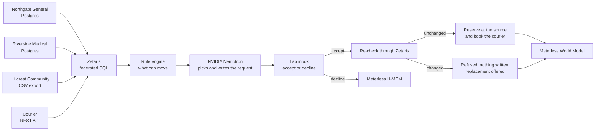

# Bloodshift

**Platelets that reach the right hospital on time.**

Bloodshift reads every hospital's live platelet stock through Zetaris, plans transfers that prevent waste, and moves a unit only after re-checking the sending hospital's own record.

**Live demo:** https://bloodshift.midelabs.xyz · synthetic hospitals, no real patients


## The problem

Platelets expire about five days after collection, faster than any other blood component. One hospital throws them out while a hospital nearby runs short, because nobody can see the whole network's live stock when the decision is made.

Moving near-expiry units between hospitals is a proven fix:

| Program | Result |
|---|---|
| BloodMove, Adelaide public hospitals | Platelet wastage fell from 17% to 7.8% ([National Blood Authority case study](https://www.blood.gov.au/sites/default/files/documents/2024-09/D15%20109791%20%20Better%20Practice%20Case%20Study%20%20BloodMove%20Platelets%20%20a%20successful%20system%20to%20significantly%20reduce%20platelet%20wastage_RT.pdf)) |
| Emory hospitals | About 20% fewer platelet outdates ([Zhang et al., Operations Research, 2023](https://ideas.repec.org/a/inm/oropre/v71y2023i5p1756-1776.html)) |

These programs still run on hand-posted stock lists, reports and phone calls. The people who feel it are the network transfusion coordinator, who rebalances stock every morning, and the lab staff at each hospital, who have to trust that a unit offered to them still exists.

## The solution

Bloodshift gives the coordinator one live view of every hospital's stock and a morning plan built from it. Each hospital's lab gets an inbox where it accepts or declines requests. Every move follows one rule:

> **No live row, no move.** A unit moves only if the sending hospital's own system still shows it available at the moment the receiving lab accepts. Every move cites that row.

Nothing is copied or synced. Each hospital keeps its own system, and Bloodshift writes back to it only through narrow, conditional updates.

## How it works



1. **Read live.** Zetaris reads two hospital Postgres databases, a third hospital's CSV export and a courier's REST API in place.
2. **Plan.** One federated SQL statement joins every hospital's available units with the courier's open slots. A deterministic rule projects which units will expire unused and keeps only the routes that pass every business rule, including a published platelet ABO and RhD selection policy.
3. **Request.** NVIDIA Nemotron chooses one option per unit from the approved list, weighs each lab's past decline reasons, and writes the request. It can't add a unit, site or slot, and its output is validated.
4. **Re-check.** When a lab accepts, one federated statement re-reads the hospital's unit row and the courier slot together. If either changed, the transfer is refused and nothing is written.
5. **Reserve and book.** The unit is reserved in the sender's own system with a conditional update, the courier is booked, and a final read through Zetaris confirms both.

Every state change is an event in the Meterless World Model, and every decline reason is kept in Meterless H-MEM for the next plan.

## Technical depth

The rule engine owns every decision that matters: which units can move, where, and whether an accept goes through. The model works only inside what the rules allow.

**Failure cases, each covered by a test:**

| Case | What happens | Test |
|---|---|---|
| Unit used at its source after the plan | Refused with the hospital's reason. No reservation, no booking, replacement offered | [accept](test/accept.test.ts#L106), [replacement](test/planner.test.ts#L202) |
| Row changes between the re-check and the write | The conditional write fails, so nothing is overwritten | [test](test/accept.test.ts#L140) |
| Courier slot taken, or courier down | Refused or failed, the reservation is released, and Retry works | [taken](test/accept.test.ts#L171), [down](test/accept.test.ts#L159) |
| Zetaris unreachable during accept | Fails without writing anything | [test](test/accept.test.ts#L149) |
| Accept double-clicked | Books once | [test](test/accept.test.ts#L187) |
| Wrong site accepts or declines | Rejected | [accept](test/accept.test.ts#L196), [decline](test/planner.test.ts#L213) |
| Nemotron invents a unit, site or option | Dropped, and the deterministic choice is used | [validator](test/nemotron.test.ts#L18), [rules](test/rules.test.ts#L184) |
| Nemotron fails or times out | One retry, then a standard template, and the plan says so | [retry](test/nemotron.test.ts#L58), [template](test/planner.test.ts#L144) |
| Decline reason tries to inject instructions | Passed to the model as data only | [test](test/planner.test.ts#L174) |
| A source is down | Stock shows partial and names the site, and the plan refuses to run on stale data | [stock](test/stock.test.ts#L49), [plan](test/planner.test.ts#L89) |
| Group O to a non-O patient, RhD-positive to RhD-negative | Never offered | [O](test/rules.test.ts#L77), [RhD](test/rules.test.ts#L80) |
| One unit or courier slot in two transfers | Never | [unit](test/rules.test.ts#L144), [slot](test/rules.test.ts#L202) |
| Server restart | Every transfer and its history survive | [test](test/transfers.test.ts#L44) |

**Results:**

| Check | Command | Result |
|---|---|---|
| Unit tests | `npm test` | 94 of 94, with a passing and a failing case for each business rule |
| Types | `npm run typecheck` | Clean |
| End-to-end | Browser run against live Zetaris, Postgres, CSV and courier | 13 of 13 checks, each write confirmed by reading the hospital's own database directly |
| Model evaluation | `npm run eval:declines` | 10 scripted decline scenarios against live Nemotron, including an injection attempt. At least 8 of 10 valid replans on every run, 10 of 10 on the last |
| Simulation | `npm run simulate` | 12.8% fewer outdates than no sharing over 20 runs of 30 days, 11.6% over 100. Synthetic demand, not a measured result |

**Stack:** TypeScript on Node 22, no framework. Self-hosted Zetaris 2.4.3.1, Postgres 16, NVIDIA NIM, the Meterless World Model and H-MEM, and plain HTML, CSS and JavaScript in the browser.

## What's new

| Existing approach | What it does | What Bloodshift does differently |
|---|---|---|
| Ontario's [ORBCoN Platelet Inventory Exchange](https://transfusionontario.org/en/?p=2496) | Staff enter short-dated units into a web app by hand | Reads each hospital's own system live, with no posting step |
| BloodMove, Emory transshipment | Proven programs run on reports, calls and policy | The same idea, run from live records with a proof trail for every move |
| A shared spreadsheet or nightly sync | Copies stock into one place | Nothing is copied, so a lab never accepts against stale data |
| An AI agent over a data warehouse | A model reads data and recommends | The model only picks among rule-approved options, and every move re-checks the source of record before anything is written |

## Demo

Open https://bloodshift.midelabs.xyz/app and follow this path:

1. **See live stock.** Three hospitals and the courier, each row labelled with its source system and the time Zetaris read it.
2. **Run the morning plan, then Send.** Each request says whether Nemotron or the standard template wrote it.
3. **Accept one.** Switch View as to Riverside Medical lab, or open [/app?view=SITE_B](https://bloodshift.midelabs.xyz/app?view=SITE_B), and click Accept. The card shows what it's checking, then Reserved with a courier booking ID.
4. **Break the rule.** On another waiting request, click Mark used. That changes the unit in the sending hospital's own database or CSV, the way its lab system would, and Bloodshift isn't told. Click Accept. It's refused with the hospital's reason, nothing is reserved or booked, and a replacement is offered.
5. **Open Proof.** The hospital's own row, read directly from its system, sits next to the exact SQL Zetaris ran at planning, at the re-check and after the writes, with the full state history.
6. **Decline one** with a reason. The unit goes to another site, and the reason appears under What you've told the network.

The demo network resets every 6 hours, at 00, 06, 12 and 18 UTC, with fresh synthetic stock and one starter round already run.

## Product and UX

- **Two roles, one app.** The coordinator sees every hospital and the plan. Each lab sees only its own inbox, with a direct link per lab (`/app?view=SITE_A`, `SITE_B`, `SITE_C`).
- **Every state is shown honestly:** loading, a partial network naming the site that's down, Zetaris unreachable, the model down with the template in use, and empty inboxes that say what will arrive.
- **Every decision is explainable** from its Proof drawer, without leaving the card.
- **Accessible:** every text element meets WCAG AA contrast, the layout works from 320px wide, and there's no horizontal scrolling.
- **[How it works](https://bloodshift.midelabs.xyz/how-it-works)** explains the loop and the rules, and **[Simulation](https://bloodshift.midelabs.xyz/simulation)** shows the 30-day result by blood group.

## Sponsor technology

| Technology | What it does here | In the code | Without it |
|---|---|---|---|
| Zetaris, self-hosted 2.4.3.1 | Reads four separately owned sources in place. One statement unions two Postgres databases and a CSV and joins them with a REST API to list every route. Another joins a hospital's unit row with a courier slot for the accept re-check. Each runs in about 0.5 to 1 second | [`ROUTES_SQL`](src/stock.ts), [`readSource`](src/accept.ts), [`ZetarisClient`](src/zetaris.ts) | Three database drivers, a CSV reader, a REST client and a hand-written join, plus a sync to see the network in one place |
| Meterless World Model | Records every transfer and state change as an event with provenance, and replays the log on restart | [`src/transfers.ts`](src/transfers.ts) | No transfer history, no restart recovery, no Proof history |
| Meterless H-MEM | Keeps each decline reason with its site, unit, transfer and time, and feeds it to the next plan as data | [`src/declineMemory.ts`](src/declineMemory.ts) | Labs that declined would be asked again |
| NVIDIA Nemotron, `nvidia/nemotron-3.5-super-vl-120b-a12b` through NIM | Chooses among rule-approved options, weighs past declines, and writes each request in one batched call per plan | [`src/nemotron.ts`](src/nemotron.ts) | A standard template writes the requests, and the plan says so |

## Limitations

- **Synthetic data only.** No real hospital, unit or patient. Not for clinical use.
- **No sign-in.** View as switches between roles. The server checks that the acting site is the receiving site, but it can't verify who is acting.
- **Zetaris only reads.** Reservations go to each hospital's own system through small adapters, so hospitals keep write control.
- **The courier is a mock service** with a REST API.
- **Mark used is a demo control.** It only works on a request still waiting on its lab. `DEMO_CONTROLS=off` removes it.
- **The clinical rules are a starting point.** Matching follows the SNBTS Policy for Platelet Selection (2014). Some business rules, like the 12-hour minimum shelf life on arrival and one unit of safety stock per group, are working assumptions and are labelled as such.
- **One process, one network,** with history in a local event log. Unaudited hackathon code.

## Setup

**Dependencies:** Node 22+, Docker, and a running Zetaris from the Zetaris Cloud "Run locally" Docker Compose bundle. An NVIDIA API key from build.nvidia.com is optional. Without one, requests use a standard template.

```bash
git clone https://github.com/mystiquemide/bloodshift.git && cd bloodshift
npm install && cp .env.example .env   # add your Zetaris login, two site passwords, optional NVIDIA_API_KEY
npm run sources:up && npm run seed    # Site A, Site B and the courier, with synthetic stock
npm run register                      # registers all four sources in Zetaris
npm start                             # http://localhost:4000, the app is at /app
```

`.env.example` documents every setting.

| Command | What it does |
|---|---|
| `npm test` | Unit tests |
| `npm run typecheck` | TypeScript checks |
| `npm run simulate` | 30-day simulation of the rule against no sharing. `npm run simulate -- 100` for more runs |
| `npm run eval:declines` | Decline scenarios against live Nemotron |
| `bash scripts/reset-demo.sh` | Fresh stock and slots, then one starter round. `STARTER=off` skips the round |
| `npm run screenshots` | Recaptures the site's product images from the running app |

**Try a refusal from the command line.** Run the plan and send it, then mark a requested unit used at its source and accept it as the receiving lab:

```bash
docker exec bs_site_a psql -U site_a -d site_a -c "UPDATE platelet_units SET status='used' WHERE unit_id='U-A-0112'"
```

`docker stop bs_site_b` shows the partial-network state, and `docker start bs_site_b` brings it back.

**Deploy to a server.** `infra/deploy.sh` sets up Zetaris and Bloodshift on one Ubuntu 24.04 server, keeps Zetaris on 127.0.0.1, serves Bloodshift over HTTPS, and installs the 6-hour demo reset. Download `zetaris-platform.zip` from Zetaris Cloud ("Run locally") onto the server, then:

```bash
sudo ZETARIS_ZIP=/root/zetaris-platform.zip MODE=standalone bash infra/deploy.sh
```

Use `MODE=proxy` when another reverse proxy already holds ports 80 and 443. The server needs about 4 GB of free memory and 15 GB of disk.

## Built during the hackathon

Built during the Open Agent Hackathon 2026 build window, from 2026-10-24. Pre-existing components, used as published: the Meterless World Model and H-MEM reference engines (Apache-2.0, vendored unmodified in [`vendor/`](vendor)) and the DM Sans font (SIL Open Font License, in [`public/fonts`](public/fonts)). Everything else in this repository was written for this project.
